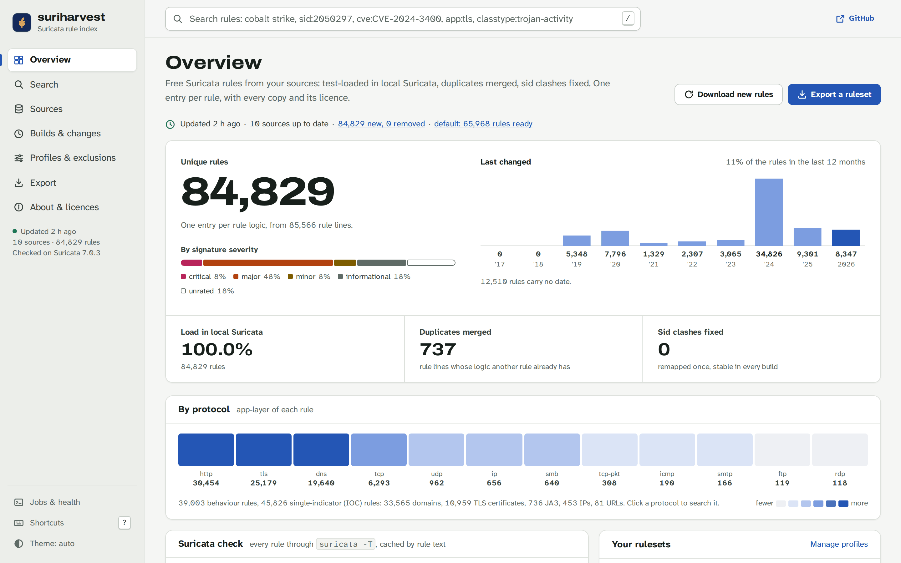
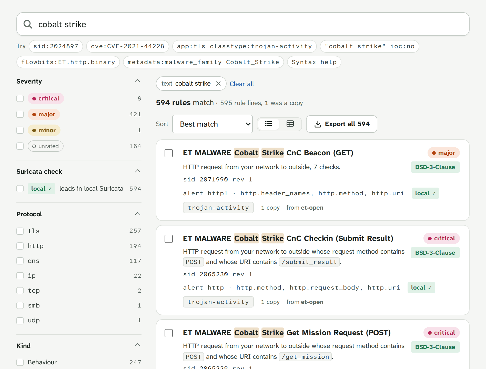
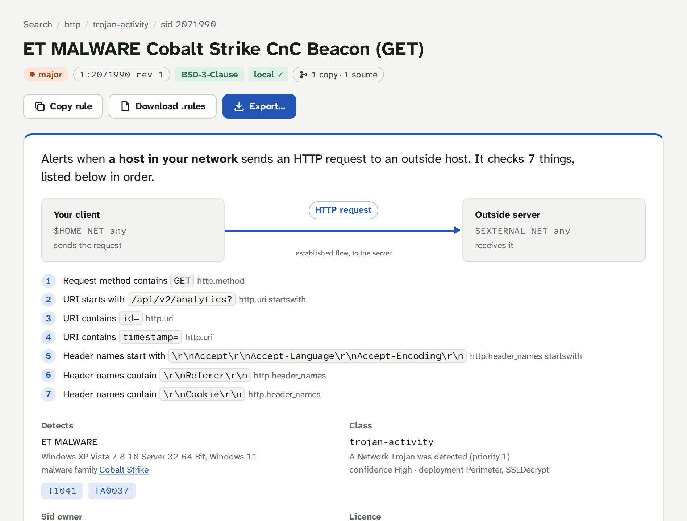
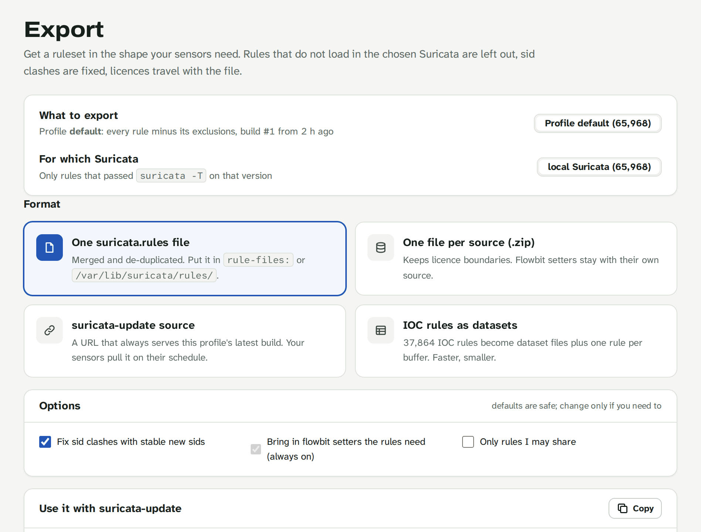
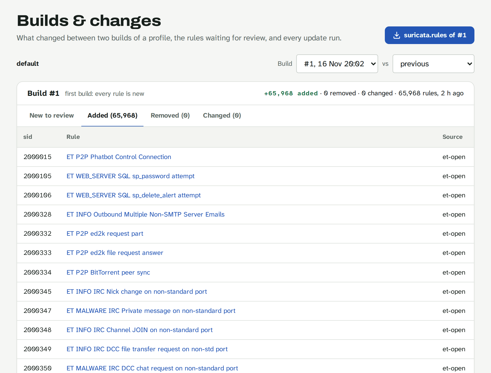
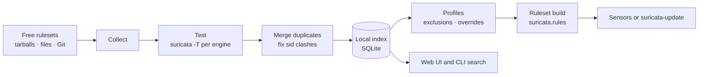

<p align="center">
  
</p>

<h1 align="center">suriharvest</h1>

<p align="center">
  <b>Free Suricata rulesets, merged, deduplicated and tested on a real engine.</b><br>
  One ruleset per Suricata version that loads cleanly, with every rule's source and licence.
</p>

<p align="center">
  <a href="https://github.com/threat-hunter-eu/suriharvest/actions/workflows/ci.yml"></a>
  <a href="https://github.com/threat-hunter-eu/suriharvest/blob/main/LICENSE"></a>
  
</p>

<p align="center">
  <a href="https://threat-hunting.eu/tools/suriharvest">Website</a> ·
  <a href="#quickstart">Quickstart</a> ·
  <a href="#what-you-get">What you get</a> ·
  <a href="#how-it-works">How it works</a> ·
  <a href="#download-the-rules">Download the rules</a> ·
  <a href="#documentation">Docs</a>
</p>

<picture>
  <source media="(prefers-color-scheme: dark)" srcset="docs/screenshots/overview-dark.png">
  
</picture>

Combining free rulesets by hand means duplicate rules under different sids, sid clashes between publishers, rules
that do not load on your Suricata version, and no record of which licence each rule carries. suriharvest downloads
the free rulesets (ET Open, abuse.ch, Stamus, OISF Traffic ID and more), tests **every rule with
`suricata -T`**, merges duplicates, fixes sid clashes with stable new sids, and builds the ruleset your sensors
load, directly or through suricata-update.

## Quickstart

You need Python 3.12+, [uv](https://docs.astral.sh/uv/) and Suricata (or Docker) to test the rules.

<!-- doctest -->
```bash
uv tool install git+https://github.com/threat-hunter-eu/suriharvest
suriharvest init ~/suri && cd ~/suri && suriharvest update   # first run: a few minutes
suriharvest serve                                            # http://127.0.0.1:8077
```

Or stay in the terminal:

<!-- doctest -->
```bash
suriharvest search 'cobalt strike ioc:no'
suriharvest profile build default          # -> data/profiles/default/latest/suricata.rules
```

`init` targets Suricata 7; for Suricata 8 sensors use `suriharvest init ~/suri --ruleset-version 8.0.8`. No
Suricata on this machine? Use a Docker engine or `update --no-validate` ([Getting started](https://github.com/threat-hunter-eu/suriharvest/blob/main/docs/getting-started.md)).

## What you get

<details open>
<summary><b>Search</b>: words and filters (sid, CVE, protocol, buffer, classtype, IOC or behaviour, loads per engine).</summary>

<picture>
  <source media="(prefers-color-scheme: dark)" srcset="docs/screenshots/search-dark.png">
  
</picture>

</details>

<details open>
<summary><b>Rule pages</b>: what the rule checks in plain words, where it loads, which rulesets use it.</summary>

<picture>
  <source media="(prefers-color-scheme: dark)" srcset="docs/screenshots/rule-dark.png">
  
</picture>

</details>

<details>
<summary><b>Export</b>: <code>suricata.rules</code>, one file per source, IOC datasets, or a suricata-update URL.</summary>

<picture>
  <source media="(prefers-color-scheme: dark)" srcset="docs/screenshots/export-dark.png">
  
</picture>

</details>

<details>
<summary><b>Profiles and builds</b>: named rulesets with exclusions (reason, review date) and a diff of every build.</summary>

<picture>
  <source media="(prefers-color-scheme: dark)" srcset="docs/screenshots/builds-dark.png">
  
</picture>

</details>

- **Tested on the real engine**: every rule goes through `suricata -T` on each engine you add (local binary or
  Docker, Suricata 7 and 8); rules that fail are left out with the reason.
- **Duplicates merged** by sid and by detection logic; **sid clashes fixed** with new sids that stay stable.
- **Flowbits aware**: a rule that needs a flowbit brings the rule that sets it.
- **Coming from suricata-update**: `profile import-conf` reads your `enable/disable/drop/modify.conf`.
- **Licence-aware**: every rule keeps its publisher's licence; `--redistributable-only` gives a file you can share.

## How it works



Updates are incremental (only changed sources are downloaded) and test results are cached by rule text, engine
and config. [Concepts](https://github.com/threat-hunter-eu/suriharvest/blob/main/docs/concepts.md), [identity and dedup](https://github.com/threat-hunter-eu/suriharvest/blob/main/docs/identity.md) and [sids](https://github.com/threat-hunter-eu/suriharvest/blob/main/docs/sids.md) explain the details.

## Download the rules

Don't want to install anything? The **suriharvest-rules** nightly release has the redistributable free rulesets,
merged, deduplicated and tested on Suricata 7 and 8, as plain `.rules` files and as a suricata-update source.
The first release (`rules-2026-11-17`): 65,968 rules per engine from 10 redistributable core sources, every file
loaded by `suricata -T` on Suricata 7.0.17 and 8.0.8 with 0 errors.

**[Latest suriharvest-rules release](https://github.com/threat-hunter-eu/suriharvest-rules/releases/latest)** (the first
release is published at launch; until then the links answer 404).

<!-- doctest: skip downloads the nightly release (root, network) -->
```bash
sudo suricata-update add-source suriharvest-8 \
  https://github.com/threat-hunter-eu/suriharvest-rules/releases/latest/download/suriharvest-8.tar.gz
sudo suricata-update
```

Use `suriharvest-7` on Suricata 7, and disable `et/open` in suricata-update: it is already inside. Every file in
the release: [docs/suricata-update.md](https://github.com/threat-hunter-eu/suriharvest/blob/main/docs/suricata-update.md) and [docs/releases.md](https://github.com/threat-hunter-eu/suriharvest/blob/main/docs/releases.md).

## Documentation

| | |
|---|---|
| **Start** | [Getting started](https://github.com/threat-hunter-eu/suriharvest/blob/main/docs/getting-started.md) · [CLI recipes](https://github.com/threat-hunter-eu/suriharvest/blob/main/docs/cli.md) · [Web UI](https://github.com/threat-hunter-eu/suriharvest/blob/main/docs/web.md) · [FAQ](https://github.com/threat-hunter-eu/suriharvest/blob/main/docs/faq.md) |
| **Rulesets** | [Profiles](https://github.com/threat-hunter-eu/suriharvest/blob/main/docs/profiles.md) · [Export](https://github.com/threat-hunter-eu/suriharvest/blob/main/docs/export.md) · [suricata-update](https://github.com/threat-hunter-eu/suriharvest/blob/main/docs/suricata-update.md) · [Sources and licences](https://github.com/threat-hunter-eu/suriharvest/blob/main/docs/sources.md) |
| **Run it** | [Releases](https://github.com/threat-hunter-eu/suriharvest/blob/main/docs/releases.md) · [Unattended updates](https://github.com/threat-hunter-eu/suriharvest/blob/main/docs/scheduling.md) · [GitHub Actions](https://github.com/threat-hunter-eu/suriharvest/blob/main/docs/automation.md) · [Architecture](https://github.com/threat-hunter-eu/suriharvest/blob/main/docs/architecture.md) |

Contributions are welcome: see [CONTRIBUTING.md](https://github.com/threat-hunter-eu/suriharvest/blob/main/CONTRIBUTING.md). Security reports: [SECURITY.md](https://github.com/threat-hunter-eu/suriharvest/blob/main/SECURITY.md).

## Maintainers

- [@angstromissa](https://github.com/angstromissa)
- [@elhoim](https://github.com/elhoim)

## Licence and attribution

suriharvest is released under the [MIT licence](https://github.com/threat-hunter-eu/suriharvest/blob/main/LICENSE). Every rule keeps its publisher's licence; the only changes
made to rule text are a new sid when two publishers clash and the path of a dataset file in `dataset` options, both
noted in each rules file's header, and every build carries a `NOTICE.md` and the licence texts
([rule licences](https://github.com/threat-hunter-eu/suriharvest/blob/main/docs/sources.md#licences)). Full details: [NOTICE](https://github.com/threat-hunter-eu/suriharvest/blob/main/NOTICE).

Not affiliated with or endorsed by SigmaHQ, OISF, Proofpoint/Emerging Threats or MITRE. Suricata and OISF are
trademarks of the Open Information Security Foundation; Emerging Threats and Proofpoint are trademarks of
Proofpoint, Inc.; MITRE ATT&CK® and ATT&CK® are registered trademarks of The MITRE Corporation (technique ids shown
are rule metadata).

The published builds and site name each rule's publisher and source as the publication states them, for
attribution. To have a rule corrected or removed, [open an issue](https://github.com/threat-hunter-eu/suriharvest/issues)
or write to security@threat-hunting.eu.
