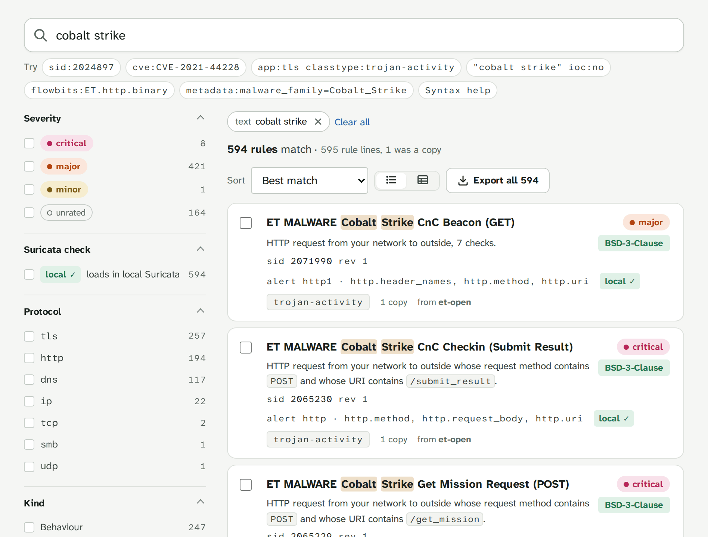
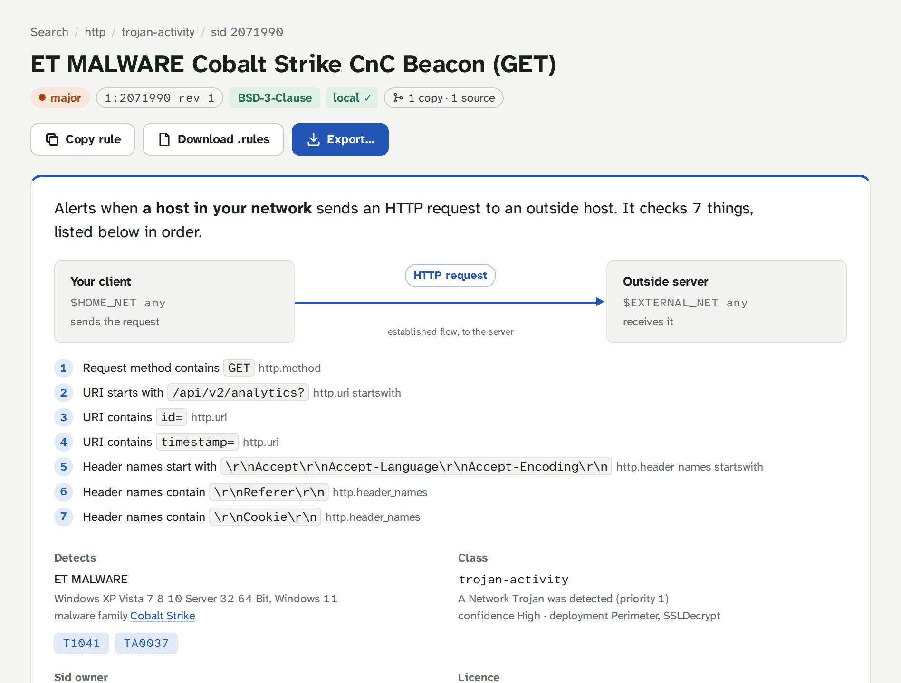
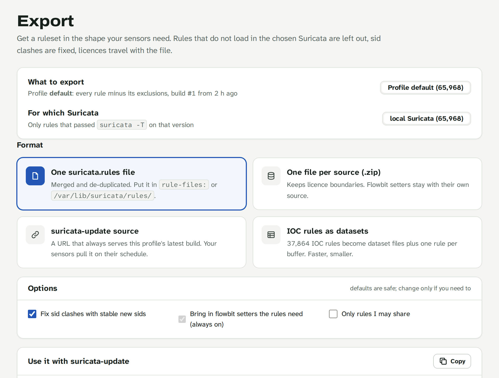
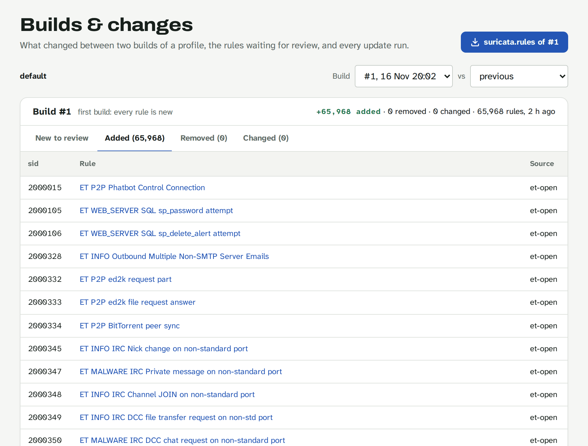
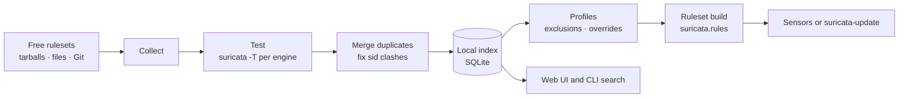

# Features

A short tour of suriharvest: what the web UI and the CLI give you, and how the pipeline gets there. To install it,
see [Getting started](getting-started.md).

## Why

Combining free rulesets by hand means duplicate rules under different sids, sid clashes between publishers, rules
that do not load on your Suricata version, and no record of which licence each rule carries. suriharvest tests
every rule on a real engine, merges duplicates, fixes sid clashes and keeps each rule's source and licence.

## What you get

<details open>
<summary><b>Search</b>: words and filters (sid, CVE, protocol, buffer, classtype, IOC or behaviour, loads per engine).</summary>

<picture>
  <source media="(prefers-color-scheme: dark)" srcset="screenshots/search-dark.png">
  
</picture>

</details>

<details open>
<summary><b>Rule pages</b>: what the rule checks in plain words, where it loads, which rulesets use it.</summary>

<picture>
  <source media="(prefers-color-scheme: dark)" srcset="screenshots/rule-dark.png">
  
</picture>

</details>

<details>
<summary><b>Export</b>: <code>suricata.rules</code>, one file per source, IOC datasets, or a suricata-update URL.</summary>

<picture>
  <source media="(prefers-color-scheme: dark)" srcset="screenshots/export-dark.png">
  
</picture>

</details>

<details>
<summary><b>Profiles and builds</b>: named rulesets with exclusions (reason, review date) and a diff of every build.</summary>

<picture>
  <source media="(prefers-color-scheme: dark)" srcset="screenshots/builds-dark.png">
  
</picture>

</details>

- **Tested on the real engine**: every rule goes through `suricata -T` on each engine you add (local binary or
  Docker, Suricata 7 and 8); rules that fail are left out with the reason.
- **Duplicates merged** by sid and by detection logic; **sid clashes fixed** with new sids that stay stable.
- **Flowbits aware**: a rule that needs a flowbit brings the rule that sets it.
- **Coming from suricata-update**: `profile import-conf` reads your `enable/disable/drop/modify.conf`.
- **Licence-aware**: every rule keeps its publisher's licence; `--redistributable-only` gives a file you can share.

## In the terminal

Everything the web UI does is also a command:

<!-- doctest -->
```bash
suriharvest search 'cobalt strike ioc:no'
suriharvest profile build default          # -> data/profiles/default/latest/suricata.rules
```

`init` targets Suricata 7; for Suricata 8 sensors use `suriharvest init ~/suri --ruleset-version 8.0.8`. No
Suricata on this machine? Use a Docker engine or `update --no-validate` ([Getting started](getting-started.md)).
More recipes: [CLI](cli.md).

## How it works



Updates are incremental (only changed sources are downloaded) and test results are cached by rule text, engine
and config. [Concepts](concepts.md), [identity and dedup](identity.md) and [sids](sids.md) explain the details.

## The nightly release

The **suriharvest-rules** nightly release has the redistributable free rulesets, merged, deduplicated and tested on
Suricata 7 and 8, as plain `.rules` files and as a suricata-update source. The first release (`rules-2026-11-17`):
65,968 rules per engine from 10 redistributable core sources, every file loaded by `suricata -T` on Suricata 7.0.17
and 8.0.8 with 0 errors. Use the `suriharvest-7` source on Suricata 7, and disable `et/open` in suricata-update: it
is already inside. Every file in the release: [suricata-update](suricata-update.md) and [Releases](releases.md).

## Licence and attribution

Every rule keeps its publisher's licence; the only changes made to rule text are a new sid when two publishers clash
and the path of a dataset file in `dataset` options, both noted in each rules file's header, and every build carries
a `NOTICE.md` and the licence texts ([rule licences](sources.md#licences)). The published builds and site name each
rule's publisher and source as the publication states them, for attribution. To have a rule corrected or removed,
[open an issue](https://github.com/threat-hunter-eu/suriharvest/issues) or write to security@threat-hunting.eu.
