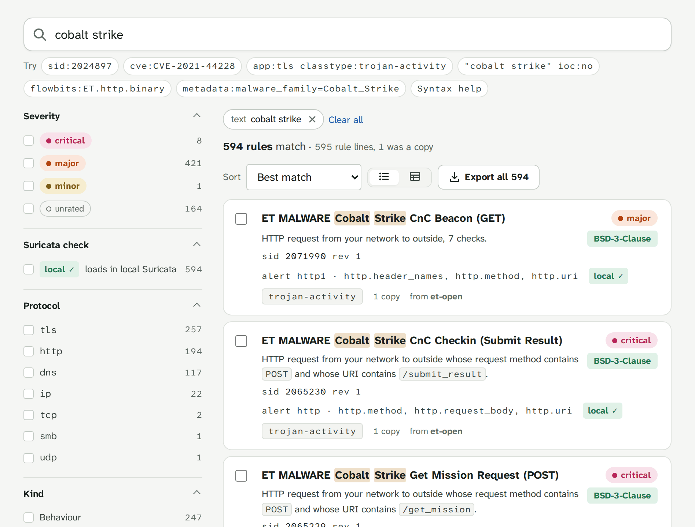

# Getting started

From nothing to a merged, validated `suricata.rules` in about ten minutes.

- [1. Install suriharvest](#1-install-suriharvest)
- [2. Get a Suricata engine for validation](#2-get-a-suricata-engine-for-validation)
- [3. Create a workspace](#3-create-a-workspace)
- [4. Collect and validate](#4-collect-and-validate)
- [5. Build your ruleset](#5-build-your-ruleset)
- [6. Look around](#6-look-around)
- [7. Keep it up to date](#7-keep-it-up-to-date)
- [No install: use the nightly release](#no-install-use-the-nightly-release)
- [Uninstall](#uninstall)

## 1. Install suriharvest

Requirements: **Python 3.12+** and [uv](https://docs.astral.sh/uv/) or [pipx](https://pipx.pypa.io/). Git is
needed only for Git sources. Linux, macOS and Windows (native, PowerShell or cmd). On Windows, WSL is still the
easiest way to get a Suricata engine for validation (`apt install suricata` inside WSL, or Docker Desktop); a native
Windows run without an engine can still collect, search and build with `--no-validate`.

<!-- doctest -->
```bash
uv tool install suriharvest
# or
pipx install suriharvest

suriharvest version
```

The development version (the `main` branch) installs from Git: `uv tool install git+https://github.com/threat-hunter-eu/suriharvest`.

Upgrade with `uv tool upgrade suriharvest` or `pipx upgrade suriharvest`.

## 2. Get a Suricata engine for validation

suriharvest checks rules with the real engine (`suricata -T`), so you know they load before they reach a sensor.
Pick one:

| Option | Command | Version you get |
|---|---|---|
| Your distribution | `sudo apt install suricata` | Ubuntu 24.04: 7.0.3 |
| OISF PPA (Ubuntu) | `sudo add-apt-repository ppa:oisf/suricata-stable && sudo apt install suricata` | latest 8.0.x |
| Docker | `docker pull jasonish/suricata:8.0.8` | exact version, no install on the host |

Ideally validate on the **same major version your sensors run**. You can use several engines at once (for example
7 and 8); see [Engines](#engines) below.

No Suricata at all? You can still collect, search and export with `suriharvest update --no-validate`, but
nothing will tell you which rules fail to load.

## 3. Create a workspace

<!-- doctest -->
```bash
suriharvest init ~/suri
cd ~/suri
```

`init` creates:

| File / folder | What it is |
|---|---|
| `sources.yaml` | the sources to collect, from the bundled catalog |
| `suriharvest.yaml` | settings: Suricata version used in source URLs, engines, sid remap base |
| `data/suriharvest.db` | SQLite database (rules, versions, validation results, profiles) |
| a profile `default` | "every enabled rule that loads in the local Suricata" |

Presets choose which catalog sources are enabled:

| `--preset` | Enabled sources |
|---|---|
| `core` (default) | the main free, redistributable sources: ET Open, abuse.ch SSLBL/JA3/Feodo, Stamus lateral, tgreen hunting, OISF Traffic ID, Hunters Ledger, Echap, nmap |
| `community` | core + licensed GitHub collections (opnsense, Antiphishing, IPFire DBL, ESET, Volexity, ...) |
| `all` | everything in the catalog, including experimental and `user-fetch` sources (PT Open, Etnetera: not republished, fetched by you) |

Sources that need a newer Suricata than `--ruleset-version` (`min_suricata`), and sources marked `dead` or
`deprecated`, stay disabled whatever the preset. `--tier T` (repeatable) picks tiers exactly, and
`--redistributable-only` keeps only `redistribute: yes` sources.

<!-- doctest -->
```bash
suriharvest init ~/suri --preset community --ruleset-version 8.0.8
```

`--ruleset-version` (old name `--suricata-version`) is the ruleset requested from sources: it fills
`${suricata_version}` in source URLs (ET Open publishes per-version builds; the catalog maps each major version to the
folder ET serves, e.g. 8.0.8 -> `suricata-8.0`). Default: the newest `--engine` version (from the image tag), else
7.0.3. Each engine validates as its own Suricata version, and a source with `min_suricata` is enabled when any
engine is new enough; only the builds of engines that are new enough contain its rules.

suriharvest finds the workspace from the current folder or the `SURIHARVEST_HOME` environment variable:

<!-- doctest -->
```bash
export SURIHARVEST_HOME=~/suri
```

### Engines

Engines live in `suriharvest.yaml`:

```yaml
ruleset_version: '8.0.8'   # old name: suricata_version
engines:
  - name: local
    binary: suricata
  - name: '8.0'
    image: jasonish/suricata:8.0.8      # Docker; pin by digest for reproducible results
```

`init --engine NAME=BINARY_OR_IMAGE` (repeatable) writes this list for you; a value containing `/` or `@` is a
Docker image. A rule's result is stored per engine. Profiles name the engine they target; rules that fail there
are left out of that profile's build.

## 4. Collect and validate

<!-- doctest -->
```bash
suriharvest doctor          # checks the workspace and probes each engine
suriharvest update
```

`update` runs the whole pipeline:

1. **sync**: downloads each enabled source (conditional requests, so unchanged sources cost almost nothing);
2. **ingest**: parses every rule, including multi-line rules, and records publisher, sid, rev and file;
3. **validate**: runs new or changed rules through `suricata -T` on every engine (cached afterwards);
4. **index**: computes identities and logic hashes, groups duplicates and families, scores rules;
5. **gates**: compares with the last good run; a source that suddenly lost most of its rules stops the run;
6. **builds**: rebuilds every profile that has auto-build on.

The first run validates ~100k rules and takes a few minutes. Later runs only validate what changed. Validation
prints a progress line (`validate local: 40,000/86,062 rules (46%), about 1 min left`) at most every 30 seconds,
also in cron logs and pipes.

### Behind a proxy

Downloads honour `HTTPS_PROXY` / `HTTP_PROXY` / `ALL_PROXY` and `NO_PROXY`. suriharvest resolves each source's
name itself, refuses internal addresses, and asks the proxy for the checked address (the real name stays in
`Host`, SNI and the certificate check). If the machine has no DNS of its own and only the proxy can resolve
names, set `SURIHARVEST_TRUST_PROXY=1`: the proxy then resolves, and it must block internal addresses itself
(details: [SECURITY.md](../.github/SECURITY.md)).

<!-- doctest: skip needs a proxy and the network -->
```bash
export HTTPS_PROXY=http://proxy.example.org:3128 NO_PROXY=localhost,127.0.0.1
suriharvest update
SURIHARVEST_TRUST_PROXY=1 suriharvest update     # only when the proxy is the only resolver
```

`skipped unique logic: no previous passed run to compare with` on the first run is normal: that gate needs a
previous run to compare with.

## 5. Build your ruleset

<!-- doctest -->
```bash
suriharvest profile build default
```

```
build default #3: 61,234 rules, 2,778 excluded of 64,012 candidates -> data/profiles/default/20261114-081200Z
  excluded by: older revision 2,747, does not load 31
  since build #2: +57 -12 ~9 rules; 4 flowbit setters added; 0 sids remapped
```

The build folder has `suricata.rules`, `manifest.jsonl` (one line per rule), `excluded.jsonl` (what was left out
and why) and `changes.json` (added, removed, and changed: a new revision of the same rule). The folder name is the
build time in UTC (`Z`), as `profile builds` and the web UI show it, and `data/profiles/default/latest` always
points at the newest build (a symlink; `LATEST` next to it holds the folder name, for systems without symlinks).
Point Suricata or your copy script at `latest`. Test the file with your sensor's configuration before you copy it
to your sensors:

<!-- doctest -->
```bash
mkdir -p /tmp/suri-test
suricata -T -c /etc/suricata/suricata.yaml -S data/profiles/default/latest/suricata.rules -l /tmp/suri-test
```

`-T` only loads the rules and exits; `-S` loads this file instead of the `rule-files` in `suricata.yaml`; `-l` is a
writable log folder (the default `/var/log/suricata` needs root). A clean load ends with "Configuration provided was
successfully loaded". If your build has dataset rules (`--iocs-as-datasets`), also load `datasets.rules` from the
same folder.

Prefer to keep suricata-update in charge of your sensor? See
[export.md](export.md#feeding-suricata-update).

## 6. Look around

<!-- doctest -->
```bash
suriharvest search 'cobalt strike'                # all words must match; quote multi-word queries
suriharvest search 'cobalt strike ioc:no'         # behaviour rules only, no single-domain/IP indicators
suriharvest search 'app:http loads:local ioc:no'
suriharvest search CVE-2021-44228                 # rules for a CVE (= cve:CVE-2021-44228)
suriharvest show 2052813                          # by sid, logic hash prefix or rule key (namespace:gid:sid)
suriharvest show et:1:2052813                     # the rule key that `show` and `search --json` print
suriharvest stats
suriharvest serve                                   # http://127.0.0.1:8077
```

Search matches words and word prefixes, and spelling variants find each other (`cobaltstrike` = `cobalt strike` =
"CobaltStrike"). Add `ioc:no` to leave out the many single-domain/IP indicator rules. Words and filters are one
argument: quote the query. The full syntax, including `cve:`, `licence:`, `metadata:` and `flowbits:`, is in
[cli.md](cli.md#filter-syntax).



The web UI has an **Overview** (rules per source, IOC vs behaviour, loads per engine), **Search** (the same query
syntax as the CLI, with facets), rule pages (copies, rev history, family, validation per engine, flowbit setters),
**Sources**, **Builds & changes** (profile builds and diffs), **Profiles & exclusions**, **Export**, **About &
licences** and **Jobs & health**. It listens on `127.0.0.1` by default; any other address needs a token (see
[web.md](web.md)).

## 7. Keep it up to date

<!-- doctest -->
```bash
suriharvest update && suriharvest profile build default
```

`update` already rebuilds every profile with auto-build on (the default), so `profile build` is only needed for
profiles without it.

To see what changed:

<!-- doctest -->
```bash
suriharvest profile diff default            # previous build vs latest ("nothing to compare yet" after the first)
suriharvest runs show latest
```

Daily with cron:

```cron
23 5 * * *  SURIHARVEST_HOME=$HOME/suri  $HOME/.local/bin/suriharvest update >> $HOME/suri/update.log 2>&1
```

A systemd service and timer are in `docs/deploy/systemd/` (`suriharvest-update.service`, `.timer` and an
`OnFailure` hook): set `SURIHARVEST_BIN` and `SURIHARVEST_HOME` in the unit, then
`systemctl enable --now suriharvest-update.timer`. See [scheduling.md](scheduling.md).

## No install: use the nightly release

<!-- doctest: skip downloads the nightly release (root, network) -->
```bash
sudo suricata-update add-source suriharvest-8 \
  https://github.com/threat-hunter-eu/suriharvest-rules/releases/latest/download/suriharvest-8.tar.gz
sudo suricata-update disable-source et/open     # ET Open is already inside: do not load it twice
sudo suricata-update
```

Use `suriharvest-7` on Suricata 7. Or download `suricata-8.rules` from the
[latest release](https://github.com/threat-hunter-eu/suriharvest-rules/releases/latest). Step by step: [suricata-update.md](suricata-update.md).

## Uninstall

<!-- doctest: skip uninstalls the tool and deletes the workspace -->
```bash
uv tool uninstall suriharvest       # or: pipx uninstall suriharvest
rm -rf ~/suri                       # the workspace: downloads, database, builds and reports
```

suriharvest writes nothing outside the workspace folder (and the tool environment uv/pipx created), apart from
short-lived download folders in the system temp folder. If you installed the systemd timer, run
`systemctl disable --now suriharvest-update.timer` and remove the unit files first; a Docker engine image you pulled
for validation stays until `docker image rm jasonish/suricata:8.0.8`.
